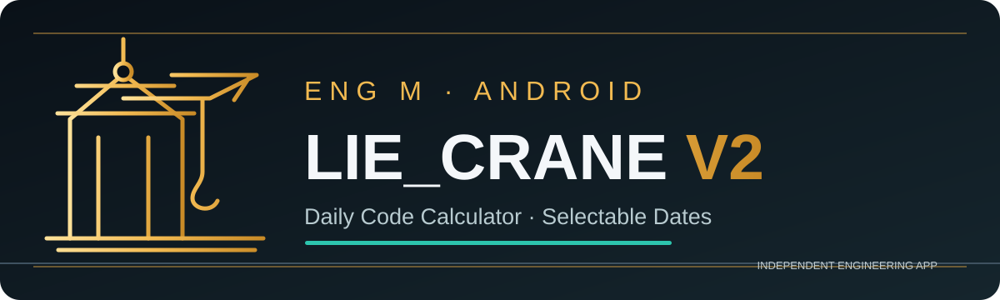
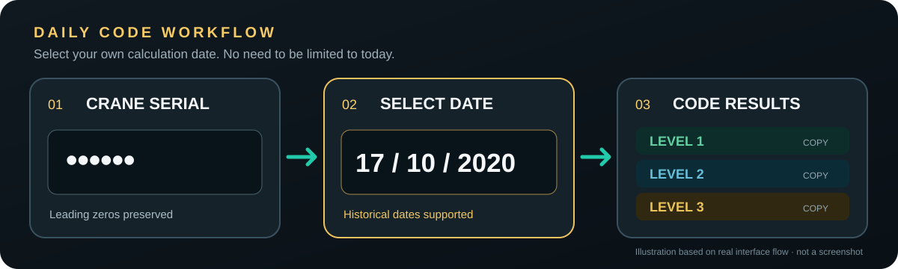

<p align="center"></p>

<h1 align="center">LIE_CRANE V2 — Liebherr Daily Code Calculator for Android</h1>
<p align="center"><strong>Selectable historical dates · Crane serial input · Three result levels · In-app trial and license support</strong></p>
<p align="center"><em>Independent third-party app for authorized mobile-crane service and maintenance professionals.</em></p>
<p align="center">
  
  
  
  
</p>

<p align="center">
  <a href="https://github.com/liecranesupport-ai/LIE-CRANE-V2/releases/download/LIECRANEV2/V2.2.4.apk"></a>
  <a href="https://github.com/liecranesupport-ai/LIE-CRANE-V2/releases/tag/LIECRANEV2"></a>
</p>

<p align="center">
  <strong><a href="https://github.com/liecranesupport-ai/LIE-CRANE-V2/releases/download/LIECRANEV2/V2.2.4.apk">Download Android APK (V2.2.4)</a></strong> · <a href="docs/INSTALL.md">Install guide</a> · <a href="https://github.com/liecranesupport-ai/LIE-CRANE-V2/releases/tag/LIECRANEV2">Release information</a>
</p>

<p align="center"><strong>Connect with LIE_CRANE V2:</strong> <a href="https://www.facebook.com/profile.php?id=61595205793839">Facebook Page</a> · <a href="https://github.com/liecranesupport-ai/LIE-CRANE-V2/releases/latest">Latest Android Release</a></p>

<p align="center">
  <a href="docs/LIEBHERR_DAILY_CODE_CALCULATOR.md"><strong>Daily Code &amp; Date Selection</strong></a> ·
  <a href="docs/FAQ.md"><strong>FAQ</strong></a> ·
  <a href="docs/INSTALL.md"><strong>Install</strong></a> ·
  <a href="docs/MEDIA_KIT.md"><strong>Media Kit</strong></a>
</p>

<p align="center">
  <a href="#-why-lie_crane-v2">Why this app</a> ·
  <a href="#-daily-codes-for-selected-dates">Change the date</a> ·
  <a href="#-download--install">Download</a> ·
  <a href="#-trial-licenses--support">Trial &amp; Support</a>
</p>

---

## ⚡ Liebherr Daily Code Calculator for Android — Choose a Date Other Than Today

**Searching for a Liebherr Daily Code Calculator that lets you select an earlier date?** LIE_CRANE V2 is an independent Android application for authorized mobile crane technicians and maintenance engineers. Its standout feature is **manual historical-date selection**—use the date shown on a crane instead of being limited to the current date.

LIE_CRANE V2 provides a mobile calculation workflow for crane serial numbers and **user-selected dates**, including historical dates. Enter the crane serial, select the relevant **day / month / year**, and review the code for the required access level.

> **Key feature: Historical-date selection.** You are **not limited to today's date**. The interface lets you change the date to match the date shown on the crane. A **Use Today** shortcut is also available.

This is a focused feature for authorized maintenance and technical workflows; supported equipment and results must be verified against the relevant manufacturer documentation.

### Designed for

**Mobile crane technicians** · **Crane maintenance engineers** · **Authorized service personnel** · **Heavy equipment technical support teams**

## 🚀 Why LIE_CRANE V2?

| Feature | What you get |
|:---|:---|
| 🗓️ **Selectable calculation date** | Choose a past or otherwise different date instead of being restricted to today. |
| 🔢 **Crane serial input** | Enter the crane serial number; leading zeros are preserved. |
| 🔐 **Three code levels** | Separate displayed results for **Level 1, Level 2 and Level 3**, where supported by the app's calculation workflow. |
| 📋 **Quick copy** | Copy the displayed result for an authorized service workflow. |
| ✅ **Verified access** | Device and license / trial status are verified with the server during calculations. |
| 🎁 **In-app trial** | Eligible users can explore the application through its built-in trial process. |
| 📱 **Device-based licensing** | View activation and remaining access time directly inside the app. |
| 🛟 **In-app support** | Contact the support team with questions or requests for assistance. |
| 🔄 **Update notifications** | The Client Portal can show when a newer app version is available. |

### 🗓️ Daily codes for selected dates

**[Explore the Liebherr Daily Code / Historical Date Guide →](docs/LIEBHERR_DAILY_CODE_CALCULATOR.md)**

The workflow displayed in the application:

**Crane serial + selected date → Calculate → Level 1 / Level 2 / Level 3 results**

1. Open **Crane Calculator** from the Client Portal.
2. Enter the crane serial number.
3. Choose **day, month and year**, or select **Use Today**.
4. Select **Calculate** to view the available results for that input.
5. Use the result appropriate to your **authorized access level**.

**Example:** A user may enter **17 October 2020** even when the current date is different. This illustrates the manual date-selection capability; it is not an assurance that any crane or access system accepts a particular result.

## 📸 App preview

The app includes a **Client Portal**, **Calculation Details**, and **Calculation Results** screens, with a dark interface, gold accents and clearly separated result levels.

<p align="center">
  
</p>

<sub>This vector diagram illustrates the workflow; it is not a screenshot. Real screenshots supplied by the developer show V2.2.3, while the published Android APK is V2.2.4. Public screenshots will be added after appropriate redaction.</sub>

## 📥 Download & install

**LIE_CRANE V2.2.4 is now officially published on GitHub Releases.**

### ➡️ [Download V2.2.4 APK (Android)](https://github.com/liecranesupport-ai/LIE-CRANE-V2/releases/download/LIECRANEV2/V2.2.4.apk)

[**View the published release**](https://github.com/liecranesupport-ai/LIE-CRANE-V2/releases/tag/LIECRANEV2) · [**Step-by-step installation guide**](docs/INSTALL.md) · [**Release information**](docs/RELEASE_BODY_v2.2.4.md) · [**Daily code date-selection guide**](docs/LIEBHERR_DAILY_CODE_CALCULATOR.md) · [**Frequently asked questions**](docs/FAQ.md)

**File:** `V2.2.4.apk` · **Size:** 2.96 MB · **Android:** 7.0+ · **Version:** 2.2.4

**Published SHA-256:**
```text
52edb324d7a5e7d335fdb9d8403fabee0d16c2cdc5ad599d9da5909080304b16
```

1. Download the original APK using the link above or via **Assets** on the GitHub Release.
2. Check the APK checksum against the value above.
3. Install with Android's regular APK installer; Android may ask permission to install from your browser or file manager.
4. Launch the app and follow the in-app registration, device verification and trial/license access process.

**Before installing over an older version:** The signing certificate must match. If the application does not install as an update, contact support rather than uninstalling a licensed installation.

Install only files from the official repository. A downloadable APK has been published, but successful installation, attestation, trial enrollment and activation on external customer devices have **not** been independently verified here.

## 💬 Trial, licenses & support

The **trial, license management, device verification and support are all handled inside LIE_CRANE V2**. No separate license-sales website is required.

- **Want to try the app?** Install it and follow the in-app access flow to check trial eligibility.
- **Want to buy or renew a license?** Use **Renew / Buy License** inside the Client Portal.
- **Need a license quote or have purchase questions?** Open **Support & Contact** in the app and message the support team.
- **Device change or activation trouble?** Contact the support team through the same in-app support flow.

Pricing and eligibility are confirmed by support; do not send payment to unverified third parties.

## 🔎 Frequently asked questions

**Can I calculate a Liebherr daily code for a date other than today?**

The app lets you enter a **different calculation date**, including a date in the past, based on the date shown on the crane.

**Does it support a crane serial number?**

Yes. The input screen accepts a serial number and preserves leading zeros.

**Does it show more than one code level?**

The illustrated results screen includes **Level 1**, **Level 2** and **Level 3** with separate copy options.

**How do I get a trial license?**

Install the app and follow its registration and trial flow. Availability depends on eligibility and server checks.

**How do I buy a LIE_CRANE V2 license?**

Use **Renew / Buy License** or **Support & Contact** inside the application. The support team handles customer questions.

**Is this an official Liebherr or LICCON application?**

**No.** LIE_CRANE V2 is an independent, third-party Android tool. References to Liebherr and LICCON describe the technical context only and **do not imply affiliation, sponsorship or manufacturer approval**.

## 🌍 Share the official app

**Official project:** https://github.com/liecranesupport-ai/LIE-CRANE-V2

For colleagues searching for **Liebherr Daily Code**, **LICCON Daily Code Calculator**, **crane serial code**, or **historical-date crane calculation**, share the **[dedicated feature guide](docs/LIEBHERR_DAILY_CODE_CALCULATOR.md)** or the **[public V2.2.4 release](https://github.com/liecranesupport-ai/LIE-CRANE-V2/releases/tag/LIECRANEV2)**.

For license purchase and activation questions, contact **Support & Contact** inside the app.

## ⚠️ Safety & authorized use

**For appropriately authorized personnel only.** Access codes can be security-sensitive. Do not use this app to bypass access controls or access equipment without permission.

This app **does not** replace OEM manuals, diagnostic authorizations, official load charts, lift plans, site safety procedures or professional judgment. Verify all technical results independently before relying on them for any maintenance or lifting operation.

## 🏷️ Relevant search terms

Liebherr Daily Code · Daily Code Calculator · Crane Daily Code · Liebherr Crane Calculator · LICCON · Mobile Crane Maintenance · Crane Service Tools · Heavy Equipment Engineering · Android Crane Calculator · Historical Date Crane Code

#Liebherr #DailyCode #CraneCalculator #LICCON #MobileCrane #CraneMaintenance #HeavyEquipment #EngineeringTools

---

<p align="center"><a href="https://www.facebook.com/profile.php?id=61595205793839"><strong>Follow LIE_CRANE V2 on Facebook</strong></a> · <a href="docs/FAQ.md">Read the FAQ</a> · <a href="docs/INSTALL.md">Install guide</a></p>

<p align="center"><strong>Developed by ENG M · LIE_CRANE V2</strong><br>
<sub>Independent app · Not affiliated with or endorsed by any crane manufacturer</sub></p>
